# UML Documentation — AI NOC (Network Operations Center)

## Daftar Diagram

| # | Diagram | Jenis UML | Keterangan |
|---|---------|-----------|------------|
| 1 | [Use Case Diagram](#1-use-case-diagram) | Behavioral | Siapa melakukan apa dalam sistem |
| 2 | [Class Diagram (Database)](#2-class-diagram-database-model) | Structural | Struktur tabel dan relasi di MySQL |
| 3 | [Sequence Diagram — Monitoring](#3-sequence-diagram--alur-monitoring-data) | Behavioral | Alur data dari Agent → MySQL |
| 4 | [Sequence Diagram — Anomaly Detection](#4-sequence-diagram--anomaly-detection-pipeline) | Behavioral | Alur AI NOC mendeteksi anomali |
| 5 | [Sequence Diagram — Event System](#5-sequence-diagram--event-system-shutdownrestartsleep) | Behavioral | Alur deteksi shutdown/restart/sleep |
| 6 | [Activity Diagram — Pipeline ML](#6-activity-diagram--ml-pipeline) | Behavioral | Flowchart proses machine learning |
| 7 | [Activity Diagram — Buffer Sync](#7-activity-diagram--buffer-sync-offline-resilience) | Behavioral | Flowchart mekanisme buffer offline |
| 8 | [Component Diagram](#8-component-diagram) | Structural | Arsitektur komponen sistem |
| 9 | [Deployment Diagram](#9-deployment-diagram) | Structural | Infrastruktur fisik dan container |
| 10 | [State Diagram — Device](#10-state-diagram--device-lifecycle) | Behavioral | Status device (online/offline/anomaly) |

---

## 1. Use Case Diagram

Menunjukkan aktor (pengguna/sistem) dan interaksi mereka dengan sistem AI NOC.

### Agent Use Cases

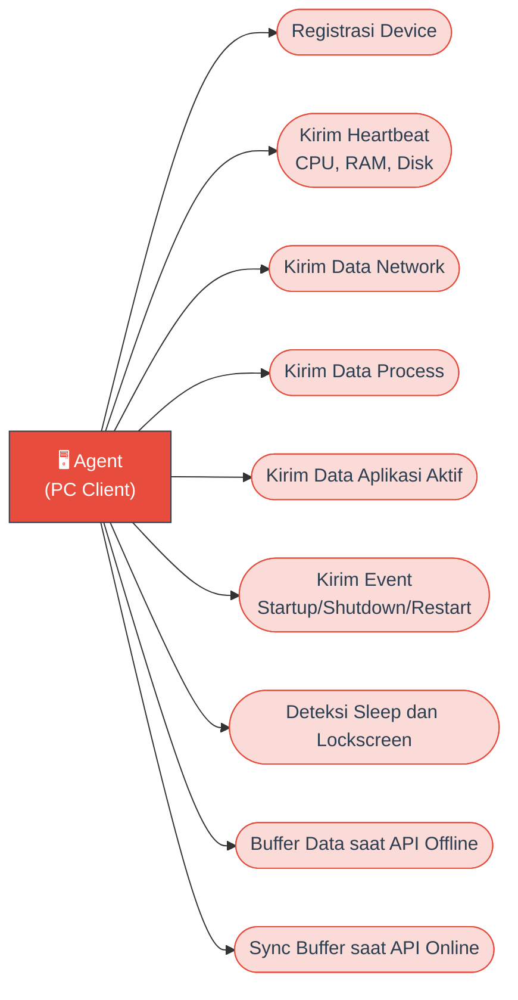

### Administrator Use Cases

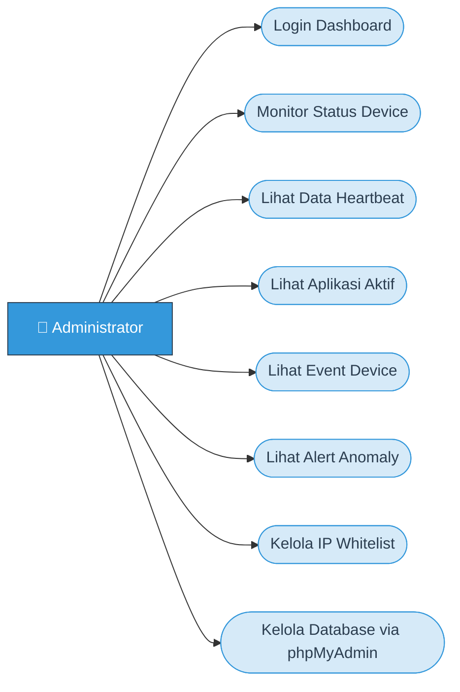

### AI NOC Use Cases

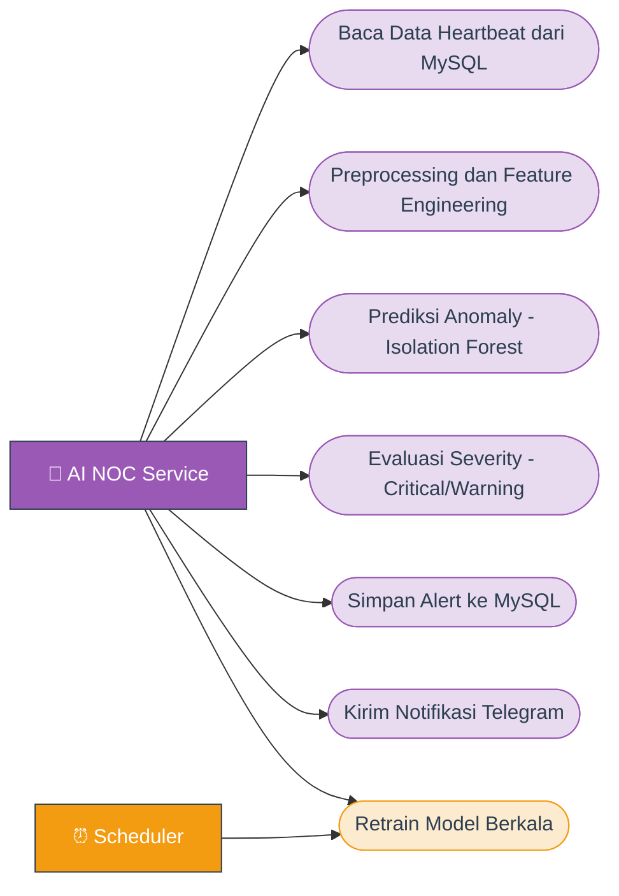
### Penjelasan Aktor

| Aktor | Jenis | Deskripsi |
|-------|-------|-----------|
| **Administrator** | Manusia | Staff IT yang memantau kesehatan infrastruktur via dashboard |
| **Agent** | Sistem | Software monitoring yang berjalan di setiap PC client |
| **AI NOC Service** | Sistem | Service ML yang mendeteksi anomali secara otomatis |
| **Scheduler** | Sistem | APScheduler yang menjalankan pipeline secara berkala |

---

## 2. Class Diagram (Database Model)

Menunjukkan struktur tabel di MySQL dan relasi antar entitas.

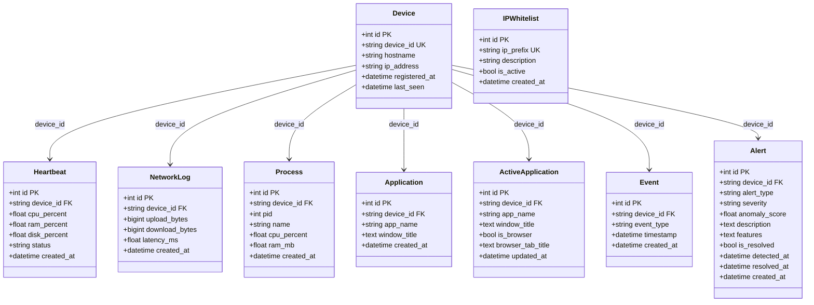

### Relasi Database (Foreign Key)

Semua tabel yang memiliki kolom `device_id` terhubung ke tabel `devices` melalui **FOREIGN KEY constraint** dengan aturan `ON DELETE CASCADE ON UPDATE CASCADE`:

| Tabel | FK Constraint | Referensi |
|-------|--------------|-----------|
| `heartbeats` | `fk_heartbeats_device` | `devices(device_id)` |
| `network_logs` | `fk_network_logs_device` | `devices(device_id)` |
| `processes` | `fk_processes_device` | `devices(device_id)` |
| `applications` | `fk_applications_device` | `devices(device_id)` |
| `active_applications` | `fk_active_apps_device` | `devices(device_id)` |
| `events` | `fk_events_device` | `devices(device_id)` |
| `alerts` | `fk_alerts_device` | `devices(device_id)` |

**Aturan CASCADE:**
- `ON DELETE CASCADE` — Jika device dihapus, semua data terkait (heartbeat, log, dll) otomatis ikut terhapus
- `ON UPDATE CASCADE` — Jika `device_id` diubah, semua referensi di tabel lain otomatis terupdate

### Penjelasan Tabel

| Tabel | Volume Data | Keterangan |
|-------|-------------|------------|
| `devices` | 1 per PC | Registrasi device yang di-monitor |
| `heartbeats` | ~1.440/hari/device | Snapshot CPU, RAM, Disk setiap 60 detik |
| `network_logs` | ~2.880/hari/device | Traffic upload/download dan latency setiap 30 detik |
| `processes` | ~288/hari/device | Top proses yang berjalan setiap 5 menit |
| `applications` | ~17.280/hari/device | Riwayat aplikasi yang dibuka setiap 5 detik |
| `active_applications` | Real-time (delta sync) | Aplikasi yang sedang aktif saat ini, sync setiap 5 detik |
| `events` | Event-driven | Startup, shutdown, restart, lockscreen, sleep |
| `alerts` | Anomaly-driven | Hasil deteksi anomali dari AI NOC |
| `ip_whitelist` | Konfigurasi | Daftar IP prefix yang diizinkan akses API |

**Perhitungan Volume Data per hari per device:**

- `heartbeats` — Dikirim setiap **60 detik** (1 menit) = **1 data/menit**
  → 1 × 60 menit × 24 jam = **1.440 data/hari**

- `network_logs` — Dikirim setiap **30 detik** = **2 data/menit**
  → 2 × 60 menit × 24 jam = **2.880 data/hari**

- `processes` — Dikirim setiap **5 menit** = **1 data/5 menit**
  → 12 per jam × 24 jam = **288 data/hari**

- `applications` — Dikirim setiap **5 detik** = **12 data/menit**
  → 12 × 60 menit × 24 jam = **17.280 data/hari**

> Semua interval bisa dikonfigurasi di file `.env` agent: `HEARTBEAT_INTERVAL`, `NETWORK_INTERVAL`, `PROCESS_INTERVAL`, `APPLICATION_INTERVAL` (dalam satuan detik).

### Tipe Event

| event_type | Trigger |
|------------|---------|
| `startup` | PC dinyalakan / agent mulai |
| `shutdown` | PC dimatikan |
| `restart` | PC di-restart (deteksi via Windows Event Log) |
| `lockscreen` | Layar dikunci (Win+L) |
| `sleep` | PC masuk mode sleep/hibernate |

---

## 3. Sequence Diagram — Alur Monitoring Data

Menunjukkan alur data dari Agent mengumpulkan data hingga tersimpan di MySQL.

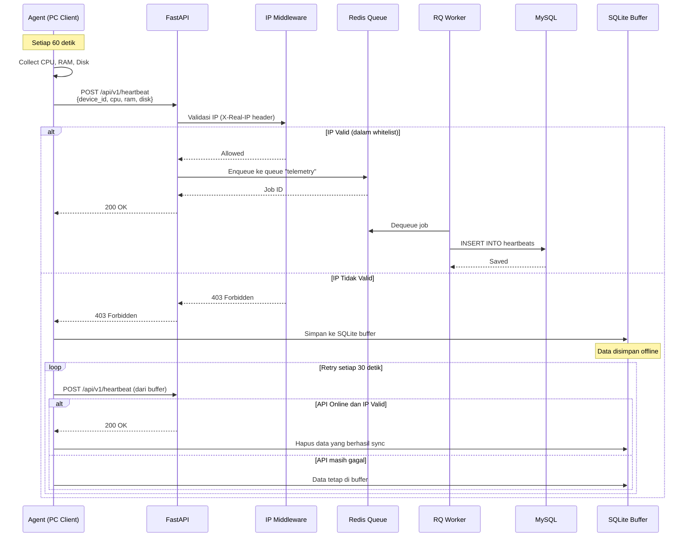

### Penjelasan Alur

1. **Agent** mengumpulkan data sistem (CPU, RAM, Disk) setiap 60 detik
2. **Agent** mengirim data ke FastAPI via HTTP POST dengan header `X-Real-IP`
3. **IP Middleware** memvalidasi IP pengirim terhadap tabel `ip_whitelist`
4. **Device Registration** menggunakan 5 skenario:
   - Scenario 1: device_id + IP cocok → update `last_seen`
   - Scenario 2: device_id tidak ada, IP ada → replace device lama (by IP)
   - Scenario 3: device_id ada, IP beda → kirim `ip_changed`, agent regenerate
   - Scenario 4: device_id + IP + hostname baru → INSERT device baru
   - Scenario 5: device_id + IP baru, tapi hostname ada → **auto-replace** device lama (by hostname)
4. Jika valid → data di-enqueue ke **Redis Queue** (queue: `telemetry`)
5. **RQ Worker** (telemetry) mengambil job dan menyimpan ke **MySQL**
6. Jika gagal (API offline/403) → data disimpan ke **SQLite buffer** lokal
7. Buffer otomatis sync saat API kembali online

---

## 4. Sequence Diagram — Anomaly Detection Pipeline

Menunjukkan alur AI NOC mendeteksi anomali dan mengirim alert.

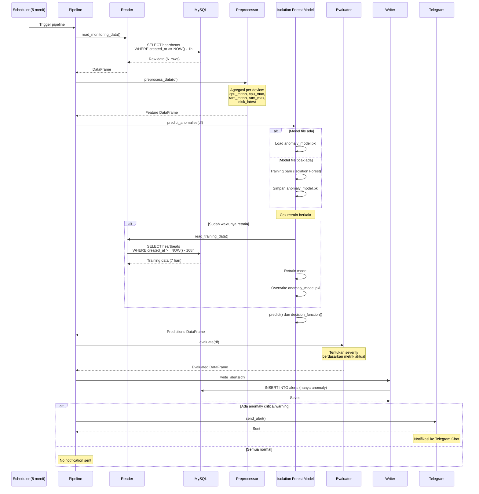

### Penjelasan Alur Anomaly Detection

1. **Scheduler** memicu pipeline setiap 5 menit (konfigurasi `ANALYSIS_INTERVAL_MINUTES`)
2. **Reader** membaca data heartbeat dari MySQL dalam 1 jam terakhir (`DATA_WINDOW_HOURS`)
3. **Preprocessor** memiliki 2 mode:
   - `preprocess_data()` → untuk **prediksi**: agregasi per device (1 row per device)
   - `preprocess_training_data()` → untuk **training**: agregasi per device + per jam (time-window 1 jam), menghasilkan ~168 sample dari 7 hari data
4. **Model** memuat file `anomaly_model.pkl` dari Docker Volume. Jika file tidak ada, model baru akan di-training otomatis menggunakan `preprocess_training_data()`
5. **Retrain Check** — Model mengecek apakah sudah waktunya retrain (berdasarkan `RETRAIN_INTERVAL_MINUTES`). Jika ya dan data cukup (>= `RETRAIN_MIN_SAMPLES`), model di-retrain dengan data 7 hari terakhir
6. **Predict** — `predict()` menghasilkan 1 (normal) atau -1 (anomaly). `decision_function()` menghasilkan `raw_score` yang dinormalisasi ke `anomaly_score` (0-1)
7. **Evaluator** menentukan severity (critical/warning) berdasarkan nilai CPU, RAM, dan Disk
8. **Writer** menyimpan alert ke tabel `alerts` di MySQL (hanya yang anomaly)
9. **Telegram** mengirim notifikasi jika ada anomaly critical atau warning

### Data Training Isolation Forest

Data yang digunakan untuk melatih model berasal dari tabel `heartbeats` di MySQL (7 hari terakhir), kemudian diproses menjadi **5 fitur** per time-window (1 jam):

| Fitur | Sumber | Arti | Contoh Normal | Contoh Anomali |
|-------|--------|------|:-------------:|:--------------:|
| `cpu_mean` | `AVG(cpu_percent)` per jam | Rata-rata penggunaan CPU dalam 1 jam | 10-40% | >85% |
| `cpu_max` | `MAX(cpu_percent)` per jam | Penggunaan CPU tertinggi dalam 1 jam | 20-60% | >90% |
| `ram_mean` | `AVG(ram_percent)` per jam | Rata-rata penggunaan RAM dalam 1 jam | 40-70% | >85% |
| `ram_max` | `MAX(ram_percent)` per jam | Penggunaan RAM tertinggi dalam 1 jam | 50-80% | >90% |
| `disk_latest` | `LAST(disk_percent)` per jam | Penggunaan disk terakhir dalam 1 jam | 50-70% | >90% |

**Contoh data training (168 sample dari 7 hari × 24 jam):**

| Jam | cpu_mean | cpu_max | ram_mean | ram_max | disk_latest | Hasil Model |
|-----|:--------:|:-------:|:--------:|:-------:|:-----------:|:-----------:|
| 08:00 | 12.5 | 25.0 | 55.3 | 62.1 | 65.0 | Normal |
| 09:00 | 35.2 | 72.0 | 68.4 | 75.5 | 65.0 | Normal |
| 14:00 | 88.7 | 99.0 | 92.1 | 98.0 | 94.0 | **Anomali** |

> Model belajar bahwa **pola normal** adalah CPU 10-50%, RAM 40-70%, Disk 50-70%. Ketika nilai menyimpang jauh (seperti Disk 94%), model mendeteksinya sebagai **anomali** karena path length di Isolation Tree pendek (mudah diisolasi).

### Parameter Konfigurasi Pipeline (.env)

| Parameter | Default | Fungsi |
|-----------|---------|--------|
| `ANALYSIS_INTERVAL_MINUTES` | `5` | Interval analisis (menit) |
| `DATA_WINDOW_HOURS` | `1` | Data yang dibaca untuk prediksi (jam) |
| `RETRAIN_INTERVAL_MINUTES` | `1440` | Interval retrain model (menit, 0=disable) |
| `RETRAIN_DATA_HOURS` | `168` | Data untuk retrain (jam = 7 hari) |
| `RETRAIN_MIN_SAMPLES` | `100` | Minimum data mentah untuk retrain |
| `CONTAMINATION` | `0.05` | Persentase anomaly yang diharapkan (5%) |
| `N_ESTIMATORS` | `100` | Jumlah tree di Isolation Forest |

---

## 5. Sequence Diagram — Event System (Shutdown/Restart/Sleep)

Menunjukkan bagaimana Agent mendeteksi dan mengirim event sistem.

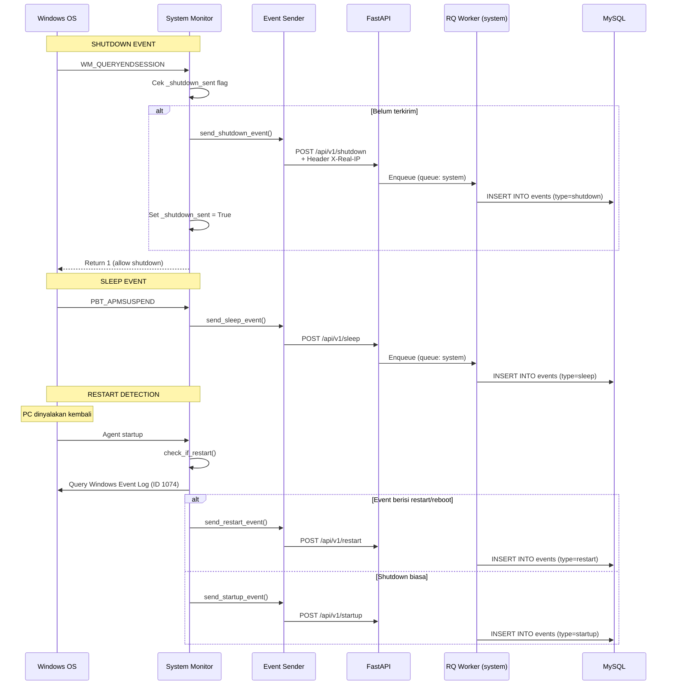

### Shutdown Protection (3 Layer)

| Layer | Mekanisme | Kapan Terpanggil |
|-------|-----------|------------------|
| 1 | `WM_QUERYENDSESSION` (Win32 Message) | Saat Windows hendak shutdown — **paling awal** |
| 2 | `SetConsoleCtrlHandler` | Console close, logoff, shutdown event |
| 3 | `atexit` handler | Saat Python process exit |

> Semua layer berbagi flag `_shutdown_sent` agar event tidak dikirim ganda.

---

## 6. Activity Diagram — ML Pipeline

Flowchart lengkap proses machine learning dari pengumpulan data hingga notifikasi.

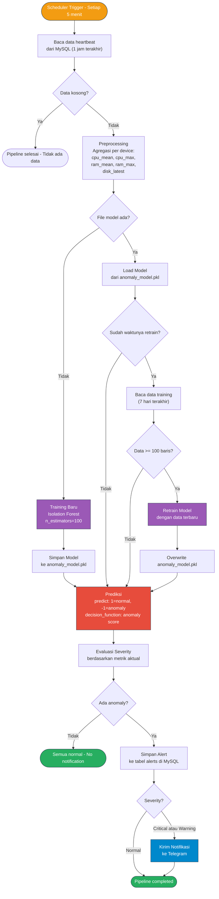

### Cara Kerja Isolation Forest

**Step 1 — Input Data (5 Fitur per Device):**

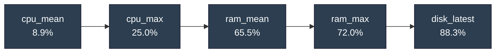

**Step 2 — Masuk ke 100 Isolation Trees:**

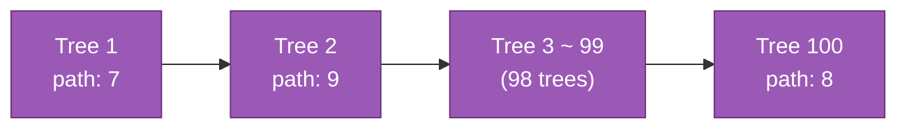

**Step 3 — Hitung Skor dan Hasil:**

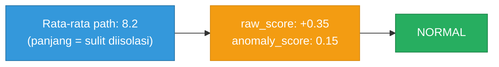

**Penjelasan Alur:**

1. **Input** — Data heartbeat diagregasi menjadi 5 fitur per device (cpu_mean, cpu_max, ram_mean, ram_max, disk_latest)
2. **Isolation Forest** — Setiap data dimasukkan ke 100 Random Trees. Setiap tree mencoba "mengisolasi" data dengan split acak. **Path length** = jumlah split yang dibutuhkan
3. **Rata-rata path** — Dihitung rata-rata path dari 100 trees. Data normal memiliki path **panjang** (sulit diisolasi), data anomali memiliki path **pendek** (mudah diisolasi)
4. **raw_score** — Output `decision_function()`. Positif = normal, negatif = anomali
5. **anomaly_score** — Dinormalisasi ke 0-1 dengan rumus `(0.5 - raw_score).clip(0, 1)`
6. **Hasil** — `predict()` menghasilkan 1 (normal) atau -1 (anomaly)

**Rumus Anomaly Score:**

```
anomaly_score = (0.5 - raw_score).clip(0, 1)
```

**Penjelasan `raw_score` (Skor Mentah):**

`raw_score` adalah output dari `model.decision_function()` milik scikit-learn Isolation Forest.
Nilainya menunjukkan seberapa "normal" atau "aneh" suatu data.

| raw_score | Arti |
|-----------|------|
| Positif besar (misal +0.35) | Data **sangat normal** — sulit diisolasi, butuh banyak split |
| Mendekati 0 | Data **di ambang batas** — bisa normal bisa anomali |
| Negatif (misal -0.15) | Data **anomali** — mudah diisolasi, hanya butuh sedikit split |

**Penjelasan `.clip(0, 1)` (Pembatas Nilai):**

`.clip(0, 1)` adalah fungsi NumPy yang membatasi nilai agar tetap dalam rentang 0 sampai 1.
Jika hasil < 0 maka dipaksa jadi 0. Jika hasil > 1 maka dipaksa jadi 1.

**Contoh Perhitungan Step-by-Step:**

| Device | raw_score | 0.5 - raw_score | .clip(0,1) | Hasil |
|--------|-----------|-----------------|------------|-------|
| A (normal) | +0.35 | 0.15 | **0.15** | Normal |
| B (ambang) | 0.00 | 0.50 | **0.50** | Warning |
| C (anomali) | -0.20 | 0.70 | **0.70** | Critical |
| D (sangat normal) | +0.80 | -0.30 | **0.00** | Normal (clip dari -0.30 ke 0) |

> Tanpa `.clip()`, Device D akan menghasilkan skor **-0.30** yang tidak valid.
> `.clip(0, 1)` memastikan anomaly_score selalu antara 0 (normal) dan 1 (sangat anomali).

| Kondisi | Severity | Aksi |
|---------|----------|------|
| prediction = 1 (normal) | Normal | Tidak ada alert |
| prediction = -1 dan CPU/RAM/Disk < 85% | Warning | Alert disimpan + Telegram |
| prediction = -1 dan CPU/RAM >= 85% atau Disk >= 90% | Critical | Alert disimpan + Telegram |
| prediction = -1 dan CPU/RAM >= 95% atau Disk >= 95% | Critical | Alert disimpan + Telegram |


### Pengaruh Data Training terhadap Deteksi Anomali

Isolation Forest adalah model **unsupervised** — model belajar pola `normal` **sepenuhnya dari data training**. Model tidak memiliki aturan tetap seperti `Disk > 90% = anomali`. Sebaliknya, model membandingkan data baru dengan **distribusi data training**.

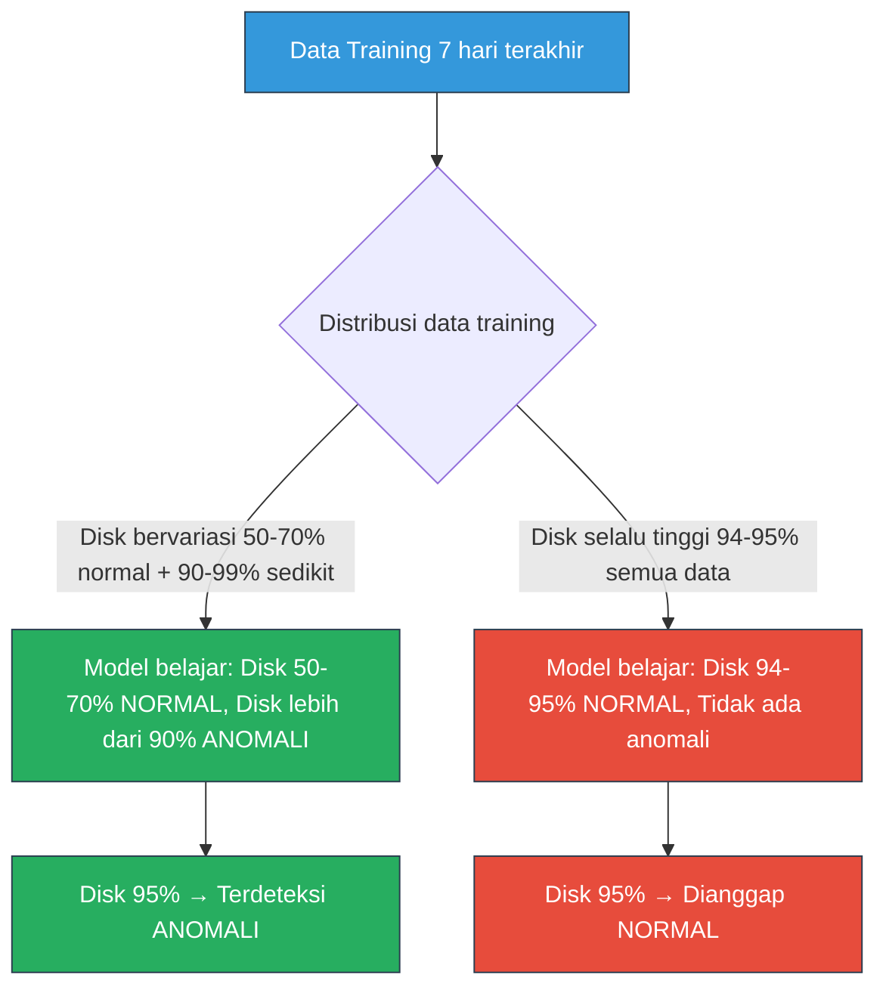

**Contoh nyata:**

| Skenario | Data Training | Disk Saat Ini | Hasil Deteksi |
|----------|--------------|:-------------:|:-------------:|
| **A. Training bervariasi** | 95 data Disk 50-70% + 5 data Disk 90-99% | 95% | ANOMALI (menyimpang dari mayoritas) |
| **B. Training monoton** | 78 data semua Disk 95% | 95% | Normal (sama dengan semua training data) |

**Kunci keberhasilan deteksi:**

> Data training **harus memiliki variasi** — mayoritas data normal (CPU rendah, RAM sedang, Disk rendah) dengan sedikit data anomali. Semakin representatif data training terhadap pola normal sehari-hari, semakin akurat model mendeteksi penyimpangan.

---

## 7. Activity Diagram — Buffer Sync (Offline Resilience)

Flowchart mekanisme buffer saat API offline dan auto-sync saat kembali online.

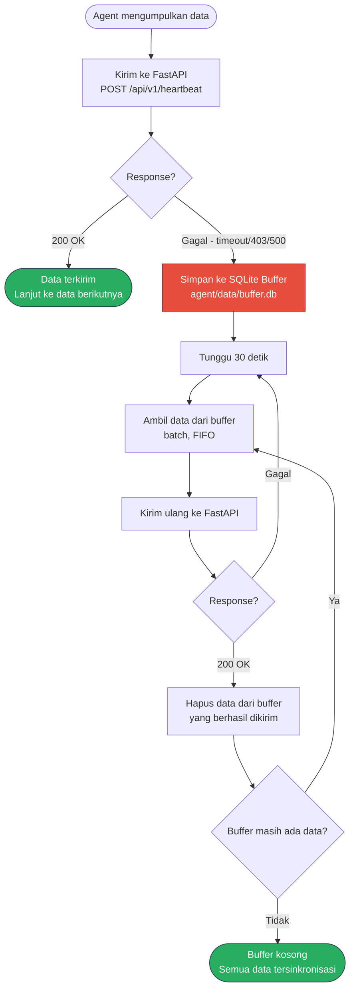

### Keuntungan Mekanisme Buffer

| Fitur | Manfaat |
|-------|---------|
| **Offline Resilience** | Data tidak hilang saat server down |
| **Auto Sync** | Otomatis kirim saat server kembali online |
| **FIFO Order** | Data dikirim sesuai urutan waktu |
| **Zero Data Loss** | Semua data monitoring tercatat |

---

## 8. Component Diagram

Menunjukkan arsitektur komponen dan dependensi antar service.

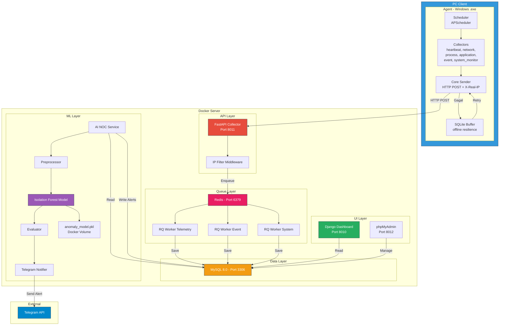

### Penjelasan Komponen

| Komponen | Layer | Fungsi |
|----------|-------|--------|
| **Collectors** | Agent | 6 modul pengumpul data: heartbeat, network, process, application, event, system_monitor |
| **Core Sender** | Agent | Mengirim data via HTTP POST dengan header `X-Real-IP`. IP dideteksi dari adapter yang routing ke server (`API_BASE_URL`), bukan `8.8.8.8` |
| **SQLite Buffer** | Agent | Menyimpan data secara lokal saat API offline, otomatis sync saat kembali online |
| **FastAPI + IP Middleware** | API | Menerima data dari agent, memvalidasi IP terhadap tabel `ip_whitelist` |
| **Redis** | Queue | Message broker yang menerima job dari FastAPI dan mendistribusikan ke worker |
| **RQ Workers (3x)** | Queue | Background processor yang memproses job dan menyimpan ke MySQL |
| **MySQL** | Data | Database utama yang menyimpan semua data monitoring, event, dan alert |
| **AI NOC** | ML | Service anomaly detection menggunakan Isolation Forest, membaca dari MySQL |
| **Telegram Notifier** | ML | Mengirim alert ke grup Telegram saat anomaly terdeteksi |
| **Django Dashboard** | UI | Web dashboard untuk administrator memantau status device dan alert |
| **phpMyAdmin** | UI | Tool web untuk manajemen database MySQL secara langsung |

### RQ Worker Queue Routing

| Queue | Worker | Data Types | Volume |
|-------|--------|------------|--------|
| `telemetry` | `noc_rq_telemetry` | heartbeat, network, process | Tinggi (~3 job/menit) |
| `event` | `noc_rq_event` | active_application, activity, alert | Sedang (~12 job/menit) |
| `system` | `noc_rq_system` | event (startup/shutdown/restart/lockscreen/sleep), device | Rendah (event-driven) |

---

## 9. Deployment Diagram

Menunjukkan infrastruktur fisik dan konfigurasi container Docker.

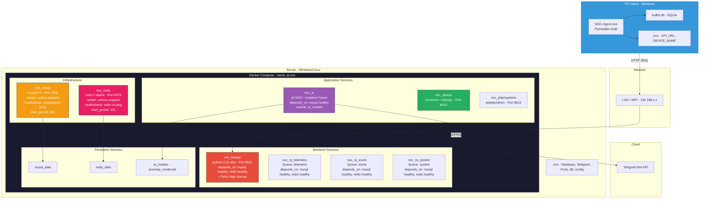

### Auto-Setup Saat Pertama Kali (Fresh Server)

Saat `docker-compose up -d` dijalankan di **komputer baru**, semua tabel dan konfigurasi dibuat **otomatis** tanpa setup manual:

| Urutan | Container | Proses Otomatis |
|:------:|-----------|----------------|
| 1 | **MySQL** | Buat database `noc_database` (dari `MYSQL_DATABASE` di `.env`) |
| 2 | **FastAPI** | `Base.metadata.create_all()` → buat 8 tabel NOC + 7 FK constraint |
| 3 | **RQ Workers** | Import semua model termasuk `Device` untuk FK resolution |
| 4 | **Django** | `entrypoint.sh` → `migrate` (buat tabel auth/admin/session) + buat superuser `admin/admin` |
| 5 | **AI NOC** | Training model otomatis saat data cukup (`RETRAIN_MIN_SAMPLES`) |

### Startup Order (Setelah Restart Server)

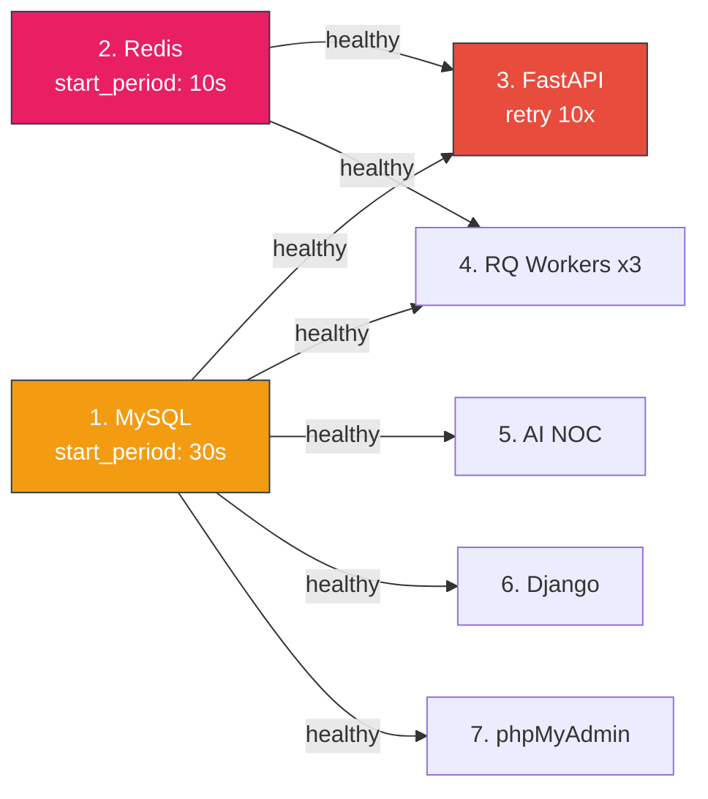

**Penjelasan Startup Order:**

Setelah server restart (atau `docker compose up`), container dimulai dalam urutan berikut:

| Urutan | Container | Syarat | Waktu Tunggu | Keterangan |
|--------|-----------|--------|-------------|------------|
| 1 | **MySQL** | - | `start_period: 30s` | Database harus siap paling awal. Healthcheck: `mysqladmin ping` |
| 2 | **Redis** | - | `start_period: 10s` | Message broker harus siap sebelum worker. Healthcheck: `redis-cli ping` |
| 3 | **FastAPI** | MySQL ✅ + Redis ✅ | Retry 10x (interval 5s) | Baru start setelah MySQL & Redis healthy. Ada retry logic internal jika DB belum siap |
| 4 | **RQ Workers (x3)** | MySQL ✅ + Redis ✅ | - | 3 worker (telemetry, event, system) start paralel setelah infra healthy |
| 5 | **AI NOC** | MySQL ✅ | - | Hanya butuh MySQL untuk baca heartbeat & tulis alert |
| 6 | **Django** | MySQL ✅ | - | Dashboard baca data dari MySQL |
| 7 | **phpMyAdmin** | MySQL ✅ | - | Tool manajemen database |

> Semua container menggunakan `restart: unless-stopped` — otomatis restart jika crash, tapi tidak restart jika dihentikan manual (`docker stop`).

> Jika MySQL belum healthy, container yang bergantung padanya **tidak akan dimulai** sampai healthcheck berhasil. Ini mencegah error koneksi saat boot.

---

## 10. State Diagram — Device Lifecycle

Menunjukkan transisi status device dari registrasi hingga deteksi anomali.

**Registrasi dan Koneksi:**

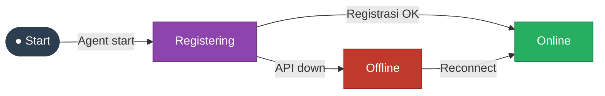

**Sleep dan Lockscreen:**

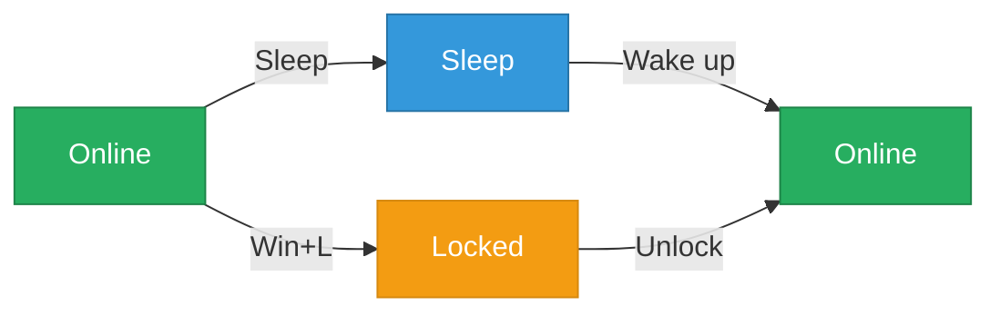

**Shutdown, Anomaly, dan Offline:**

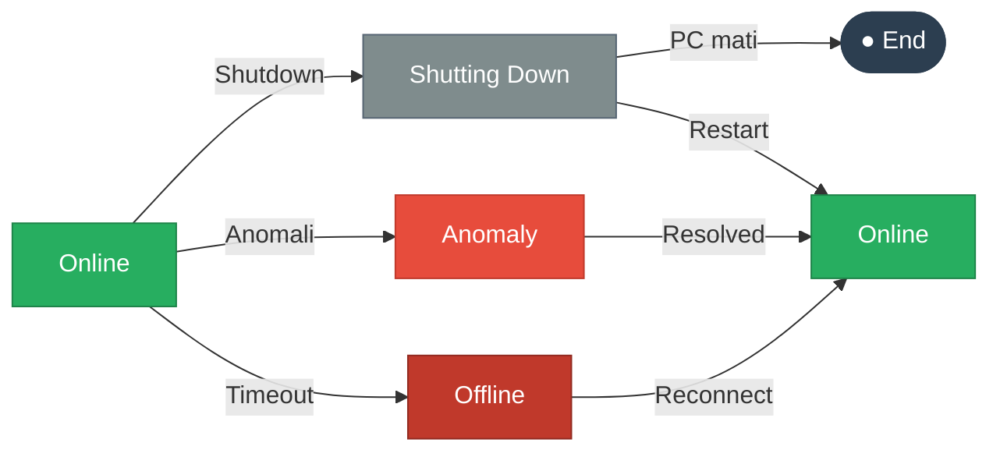

**Transisi antar state:**

| Dari | Ke | Trigger |
|------|-----|---------|
| `[*]` | Registering | Agent pertama kali dijalankan |
| Registering | Online | POST /device-registration → 200 OK |
| Registering | Offline | Registrasi gagal (API down) |
| Online | Online | Heartbeat diterima (setiap 60 detik) |
| Online | Sleep | Event `PBT_APMSUSPEND` terdeteksi |
| Online | Locked | Event lockscreen (Win+L) terdeteksi |
| Online | Shutting Down | Event shutdown/restart terdeteksi |
| Online | Anomaly Detected | AI NOC mendeteksi anomali (score tinggi) |
| Online | Offline | Heartbeat timeout (lebih dari 3 menit) |
| Sleep | Online | Wake up (`PBT_APMRESUMESUSPEND`) |
| Locked | Online | Unlock screen |
| Shutting Down | `[*]` | PC mati |
| Shutting Down | Online | Restart → startup event dikirim |
| Anomaly Detected | Online | Alert resolved / metrik kembali normal |
| Offline | Online | Heartbeat diterima kembali (buffer sync) |

### Penjelasan State

| State | Deskripsi | Trigger Masuk | Trigger Keluar |
|-------|-----------|---------------|----------------|
| **Registering** | Device baru, belum terdaftar | Agent pertama kali jalan | Registrasi berhasil/gagal |
| **Online** | Normal, heartbeat aktif | Heartbeat diterima | Timeout/event/anomaly |
| **Sleep** | PC dalam mode sleep | PBT_APMSUSPEND | Wake up |
| **Locked** | Layar terkunci | Win+L / timeout screen | Unlock |
| **ShuttingDown** | PC sedang dimatikan | WM_QUERYENDSESSION | PC mati / restart |
| **Anomaly** | AI NOC mendeteksi masalah | Anomaly score tinggi | Metrik kembali normal |
| **Offline** | Agent tidak bisa kontak API | Timeout / API down | API kembali online |

---

## Ringkasan Arsitektur

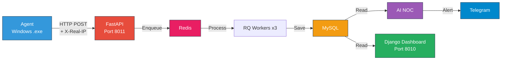

| Komponen | Teknologi | Fungsi |
|----------|-----------|--------|
| **Agent** | Python + PyInstaller (.exe) | Monitoring PC client |
| **FastAPI** | Python + Uvicorn | API endpoint penerima data |
| **Redis** | Redis 7 Alpine | Message broker (antrian task) |
| **RQ Workers** | Python-RQ (3 dedicated) | Background job processor |
| **MySQL** | MySQL 8.0 | Database utama |
| **AI NOC** | scikit-learn (Isolation Forest) | Anomaly detection + Telegram |
| **Django** | Django + Gunicorn | Dashboard monitoring |
| **phpMyAdmin** | phpMyAdmin | Database management |